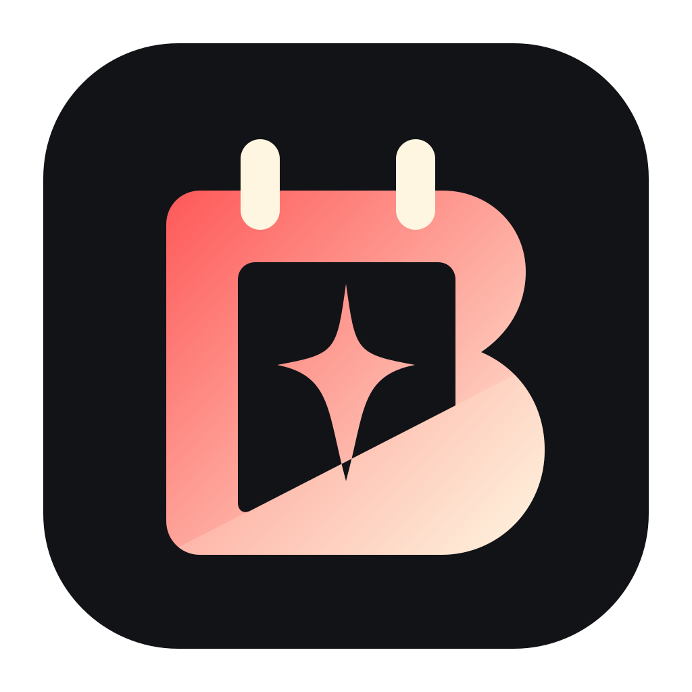
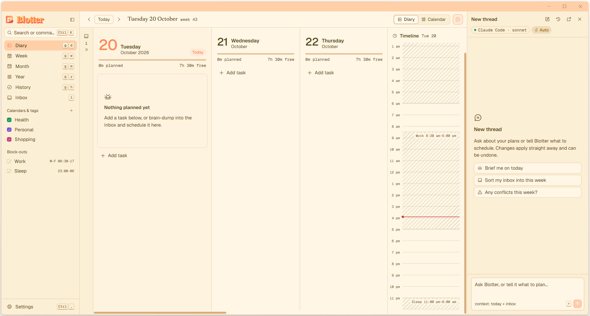

<p align="center"></p>

# Blotter

A keyboard-first daily planner with an AI that pencils things in for you.

The name comes from the desk blotter (the paper calendar pad on a desk) and from _blotting out_ time, which is what block-out windows do.

<picture>
  <source media="(prefers-color-scheme: dark)" srcset="docs/screenshots/diary-dark.png">
  <source media="(prefers-color-scheme: light)" srcset="docs/screenshots/diary-light.png">
  
</picture>

- **Diary, Week, Month and Year** views, all usable from the keyboard alone.
- An **Inbox** to brain-dump tasks into, then place them with the built-in auto-slot, the AI's **Smart slot**, or **Consult me**, where the AI asks you about each task before placing it.
- **Task windows** ("book the trip between 1 and 15 Nov") and **weekly tasks** (groceries some time each week, usually Saturday morning) that re-plan themselves when a slot is missed.
- **Holidays** that lift your block-outs for their days and keep work tasks off them.
- **Block-out windows** (work 08:30–17:00 on weekdays, say) that flexible tasks never land in. Fixed appointments can still go there.
- An **AI chat** that reads and changes your planner. By default it _proposes_ changes for you to accept; every change is logged and undoable, with snapshots to roll back to.
- **Reminders** with snooze, which keep firing from the tray while the window is closed.
- **ICS** export, import and calendar subscriptions (a published Outlook or Google calendar can act as a block-out).
- A **theme editor** with live preview, a **keybinding editor**, and completion **history** with streaks.
- An **MCP server**, so Claude Desktop, Claude Code and other MCP clients can use your planner too.

Windows 10/11 and Linux. MIT licensed.

## Install

Download from the [latest release](https://github.com/LASR-0/Blotter/releases/latest).

| Platform       | Package                        | Notes                                                              |
| -------------- | ------------------------------ | ------------------------------------------------------------------ |
| Windows 10/11  | `Blotter_x.y.z_x64-setup.exe`  | Installs for your user, no admin needed.                           |
| Windows 10/11  | `Blotter_x.y.z_x64_en-US.msi`  | For managed installs.                                              |
| Linux          | `Blotter.flatpak`              | `flatpak install --user Blotter.flatpak`. See [Flatpak](#flatpak). |
| Linux          | `Blotter_x.y.z_amd64.AppImage` | `chmod +x` it and run.                                             |
| Debian, Ubuntu | `Blotter_x.y.z_amd64.deb`      | `sudo apt install ./Blotter_x.y.z_amd64.deb`                       |
| Arch           | AUR `blotter`                  | Builds from source; see `packaging/aur`.                           |

Releases aren't code-signed, so Windows SmartScreen may warn the first time ("More info" → "Run anyway"). There's no auto-update in v1: install a new release over the old one, and your data stays put.

On Linux, file pickers use the desktop portal (`xdg-desktop-portal` plus a backend such as `-gtk`, `-kde` or `-hyprland`), and the tray needs a StatusNotifier host (KDE, GNOME with the AppIndicator extension, Waybar's tray, …).

### Flatpak

The Flatpak asks only for what Blotter needs: network (AI providers, ICS subscriptions), notifications, the tray, the Secret Service keychain, and `~/.config/autostart` for launch at login. Two things differ from the other packages:

- **Claude Code** runs on your system, outside the sandbox. To use it as Blotter's AI, allow Blotter to start host programs:

  ```sh
  flatpak override --user --talk-name=org.freedesktop.Flatpak io.github.lasr0.Blotter
  ```

  The API-key providers work without this.

- Commands go through `flatpak run`: quick capture is `flatpak run io.github.lasr0.Blotter --capture`, and the MCP server is `flatpak run --command=blotter io.github.lasr0.Blotter mcp`. Settings → AI providers shows the exact lines.

## First run

A short setup walks through a theme, your week and planning hours, your work hours as a first block-out, connecting an AI, and launch at login, each one skippable. Everything can be changed later in Settings, and **Run setup again** in the command palette (`Ctrl+K`) brings it back.

Your data is a single SQLite database:

- Windows: `%APPDATA%\io.github.lasr0.Blotter\blotter.db`
- Linux: `~/.local/share/io.github.lasr0.Blotter/blotter.db` (Flatpak: under `~/.var/app/io.github.lasr0.Blotter/data/`)

Snapshots go in a `snapshots` folder next to it (Settings → Backups). Set `BLOTTER_DATA_DIR` to use another folder.

## AI

Settings → AI providers offers three routes:

- **Claude Code** (recommended). Blotter drives your installed, signed-in [`claude`](https://docs.claude.com/en/docs/claude-code) program headless, with Blotter's MCP server as its tools, so it runs on your existing Claude subscription. Install Claude Code and sign in first. Blotter finds it on your `PATH` or in the usual install folders, or you can set the path.
- **Codex**. The same for OpenAI's [Codex CLI](https://developers.openai.com/codex/cli): install it (`npm i -g @openai/codex`) and sign in with `codex login`, and it runs on your ChatGPT plan. Codex's own shell, file, web and app tools are switched off; it gets Blotter's tools only.
- **API keys**: Anthropic, OpenAI, or any OpenAI-compatible endpoint (Ollama, LM Studio, GitHub Models, …). Keys are kept in the system keychain (Windows Credential Manager, or the Secret Service on Linux). These are marked _Experimental_ until they've been tried against the real services.

The chat header switches between **Propose**, the default, where changes wait as pencilled-in proposals you accept or reject, and **Auto**, where they apply at once (still logged, undoable and snapshotted). The switch covers MCP clients too. Block-outs and planning hours are enforced by the planner whatever the AI asks for.

## MCP server

`blotter mcp` serves the planner's operations over stdio to any MCP client, with or without Blotter open. Changes show in the open app within a second, are logged as `mcp`, undo with `Ctrl+Z`, and follow the Propose/Auto switch. Settings → AI providers → MCP server has copy buttons with your exact paths.

Claude Code:

```sh
claude mcp add --transport stdio --scope user blotter -- "C:\Users\you\AppData\Local\Blotter\blotter.exe" mcp
```

On Linux the program is `/usr/bin/blotter` (deb, AUR), the AppImage's path, or `flatpak run --command=blotter io.github.lasr0.Blotter`.

Claude Desktop (`claude_desktop_config.json`):

```json
{
  "mcpServers": {
    "blotter": {
      "command": "C:\\Users\\you\\AppData\\Local\\Blotter\\blotter.exe",
      "args": ["mcp"]
    }
  }
}
```

## Linux desktop notes

### Quick capture on Wayland

Global shortcuts don't work on Wayland, so instead of `Ctrl+Shift+Space` (Windows and X11) you bind a command in your compositor. A running Blotter picks it up; otherwise Blotter starts in the tray and opens it.

Hyprland (`~/.config/hypr/hyprland.conf`):

```ini
bind = SUPER SHIFT, SPACE, exec, blotter --capture
bind = SUPER SHIFT, C, exec, blotter --chat
# Flatpak: exec, flatpak run io.github.lasr0.Blotter --capture
```

### Hyprland window rules

Wayland doesn't let apps keep themselves on top, so give the quick-capture popup and the chat pop-out rules of their own:

```ini
windowrulev2 = float, title:^(Blotter quick capture)$
windowrulev2 = center, title:^(Blotter quick capture)$
windowrulev2 = pin, title:^(Blotter quick capture)$
windowrulev2 = float, title:^(Blotter chat)$
windowrulev2 = pin, title:^(Blotter chat)$
```

### NVIDIA

WebKitGTK can draw a blank or flickering window on NVIDIA under Wayland. Blotter sets `WEBKIT_DISABLE_DMABUF_RENDERER=1` for itself at startup unless you've set it yourself; set it to `0` to try the DMA-BUF renderer anyway.

### Launch at login

Settings → General → Launch at login adds an autostart entry that starts Blotter hidden in the tray (`--hidden`), so reminders fire after a restart. Closing the window keeps Blotter in the tray; quit from the tray menu or with `Ctrl+Q`.

## Keyboard

Press `?` in the app for the full list, and `Ctrl+K` for the command palette, which runs any action by name. Every binding can be changed in Settings → Keybindings.

| Keys                          | Action                                                                |
| ----------------------------- | --------------------------------------------------------------------- |
| `Ctrl+K`                      | Command palette                                                       |
| `?`                           | Keyboard shortcuts                                                    |
| `n`                           | Quick add, e.g. `dentist tue 3pm ~45m #health // bring the referral`  |
| `Ctrl+Shift+Space`            | Quick capture, system-wide (Windows, X11)                             |
| `g d` `g w` `g m` `g y` `g h` | Diary, Week, Month, Year, History                                     |
| `i`                           | Inbox                                                                 |
| `v`                           | Switch between the Diary and the calendar                             |
| `[` `]` `.`                   | Previous period, next period, today                                   |
| `Ctrl+B`                      | Toggle the sidebar                                                    |
| `Ctrl+,`                      | Settings                                                              |
| `h j k l` or arrows           | Move focus                                                            |
| `Shift+←↑↓→`                  | Move the focused item (a day, or 15 minutes)                          |
| `Alt+↑↓`                      | Make the focused item 15 minutes longer or shorter                    |
| `Enter` / `e`                 | Open / edit the focused item                                          |
| `x`                           | Toggle complete                                                       |
| `s`                           | Auto-slot the selected or focused task                                |
| `Delete`                      | Delete the focused item                                               |
| `Space`                       | Select a task (Inbox)                                                 |
| `d` `t` `p` `u`               | Bulk schedule, duration, priority, due date (Inbox, with a selection) |
| `Tab`                         | Switch between items and the time cursor (Week)                       |
| `b l`                         | Lift block-outs on the focused day                                    |
| `Ctrl+Z` / `Ctrl+Shift+Z`     | Undo / redo, your changes and the AI's                                |
| `Ctrl+/`                      | Toggle the AI chat                                                    |
| `Ctrl+Shift+/`                | Pop the chat out                                                      |
| `Ctrl+Q`                      | Quit                                                                  |

## Build from source

Needs Rust 1.88+, Node 24 and pnpm. On Linux, also WebKitGTK 4.1 and friends:

```sh
sudo apt install libwebkit2gtk-4.1-dev libayatana-appindicator3-dev librsvg2-dev libxdo-dev libssl-dev patchelf
```

```sh
pnpm install
pnpm tauri dev          # run with hot reload
pnpm dev:demo           # the same, on a seeded demo database
pnpm check              # typecheck, lint, format, Vitest
cargo test --workspace  # Rust tests
pnpm tauri build        # installers and bundles in target/release/bundle
```

Packaging lives in `packaging/`: the Flatpak manifest, the AUR `PKGBUILD`, and the desktop entry and AppStream metadata. Pushing a `v*` tag runs `.github/workflows/release.yml`, which builds every artifact into a draft release.

## Licence

[MIT](LICENSE)
